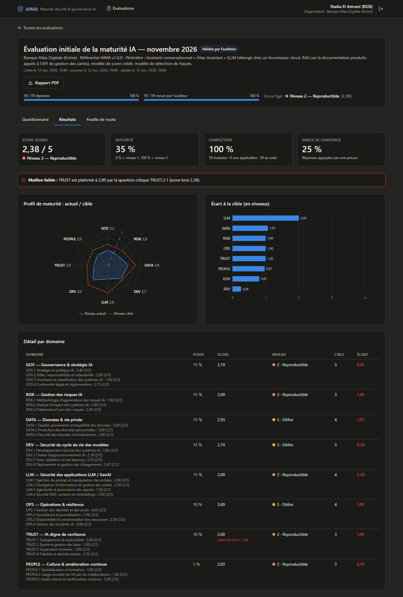
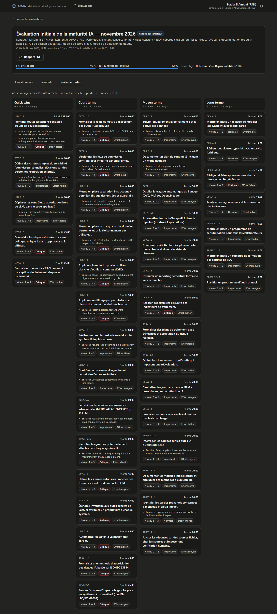

# 09 — Étude de cas : Banque Atlas Digitale (Livrable 5)

> **Organisation fictive.** Le nom, les personnes et les situations décrites sont inventés pour illustrer la
> démarche. Les chiffres de ce document ne sont pas inventés : ils ont été **calculés par la plateforme AIMA**
> à partir des réponses du scénario.
>
> - Scénario (réponses, preuves, corrections de l'auditeur) : [`scripts/case-study/scenario-banque-atlas.json`](../scripts/case-study/scenario-banque-atlas.json)
> - Rejouer l'étude de cas : `node scripts/case-study/run.mjs` (avec la plateforme démarrée)
> - Rapport PDF produit : [`etude-de-cas/rapport-banque-atlas.pdf`](etude-de-cas/rapport-banque-atlas.pdf)
> - Données brutes : [`etude-de-cas/resultats.json`](etude-de-cas/resultats.json)

## 1. Contexte

**Banque Atlas Digitale** est une banque de détail marocaine de taille intermédiaire (ETI) : 1 800
collaborateurs et 45 agences. Elle est **certifiée ISO/IEC 27001 depuis 2022** : sa sécurité informatique
« classique » est donc structurée. En revanche, elle a déployé l'IA rapidement, sans cadre spécifique.

| Système IA | Description | Risques principaux |
|---|---|---|
| **Atlas Assistant** | Assistant conversationnel client. LLM hébergé chez un fournisseur cloud, RAG sur la documentation produits, appels à l'API de gestion des cartes (blocage / déblocage) | Injection de prompt, fuite de données, actions non autorisées (OWASP LLM01, LLM02, LLM06) |
| **Score crédit** | Modèle d'aide à la décision d'octroi de crédit | Biais et discrimination, explicabilité (NIST AI RMF « Fair », ISO/IEC 42001) |
| **Détection de fraude** | Modèle de détection des transactions carte frauduleuses | Dérive du modèle, empoisonnement des données |

**Contexte réglementaire.** La banque est soumise à la loi 09-08 sur la protection des données personnelles,
contrôlée par la CNDP, et aux exigences du régulateur bancaire en matière de risques informatiques. Elle suit
aussi l'AI Act européen, à cause de ses clients et partenaires dans l'Union européenne. Dans l'AI Act,
l'évaluation de la solvabilité figure parmi les systèmes **à haut risque** (annexe III).

## 2. Déroulement de l'évaluation

| Étape | Acteur | Ce qui se passe dans AIMA |
|---|---|---|
| 1. Cadrage | Administrateur | Création de l'organisation, du compte de la RSSI (`ORG_USER`) et du compte de l'auditeur (`AUDITOR`) |
| 2. Cibles | RSSI | Cible 3 (« Défini ») partout, **4 pour LLM, DATA et OPS**, les domaines les plus exposés pour une banque |
| 3. Auto-évaluation | RSSI | 59 réponses, dont 15 avec une preuve (indice de confiance : **25,4 %**) |
| 4. Soumission | RSSI | Réponses verrouillées. Score déclaré : **2,39** |
| 5. Audit | Auditeur | Revue des 59 réponses : 56 confirmées, **3 corrigées** avec un commentaire obligatoire |
| 6. Validation | Auditeur | Score audité figé : **2,38 / 5, niveau 2 « Reproductible »** |
| 7. Restitution | Tous | Résultats, feuille de route (42 actions) et rapport PDF de 6 pages |



## 3. Résultats

### 3.1 Vue globale

| Indicateur | Valeur | Lecture |
|---|---|---|
| Score global | **2,38 / 5** (34,5 %) | Niveau 2 « Reproductible » : des pratiques existent, mais elles sont informelles et inégales |
| Complétion | 100 % (59/59) | Aucune question « Non applicable » : les 3 systèmes couvrent tout le référentiel |
| Indice de confiance | 25,4 % | Seule une réponse sur quatre est appuyée par une preuve. Le résultat repose surtout sur du déclaratif, d'où l'intérêt du mode audit |
| Actions recommandées | 42 | 5 quick wins, 15 à court terme, 15 à moyen terme, 7 à long terme |

### 3.2 Résultats par domaine

| Domaine | Poids | Déclaré | **Audité** | Cible | Écart | Remarque |
|---|---|---|---|---|---|---|
| GOV — Gouvernance | 15 % | 2,34 | **2,19** | 3 | 0,81 | Corrigé par l'audit (politique IA non approuvée) |
| RISK — Risques | 15 % | 2,00 | **2,00** | 3 | 1,00 | Pas de méthode de risques propre à l'IA |
| DATA — Données | 15 % | 2,93 | **2,93** | 4 | 1,07 | Bon socle de conformité (loi 09-08) |
| DEV — Cycle de vie | 15 % | 2,74 | **2,74** | 3 | 0,26 | Proche de la cible ; aucun red teaming |
| **LLM — Applications LLM** | 15 % | 2,00 | **2,00** | **4** | **2,00** | **Écart le plus important** |
| OPS — Opérations | 10 % | 2,88 | **3,00** | 4 | 1,00 | Seul domaine au niveau 3 « Défini », grâce à la certification ISO 27001 |
| TRUST — IA de confiance | 10 % | 2,00 | **2,00** | 3 | 1,00 | **Plafonné** par TRUST.2.1 (brut 2,38) |
| PEOPLE — Culture | 5 % | 2,03 | **2,03** | 3 | 0,97 | Shadow AI non détecté |

**Le profil en un coup d'œil (radar).** La banque est solide sur ce que couvre déjà ISO 27001 :
- les accès : OPS.1 = 4,00 ;
- les secrets : DEV.1.2 = 4 ;
- le chiffrement : DATA.3.2 = 4.

Elle est faible sur ce qui est **propre à l'IA** :
- l'agentivité du LLM : LLM.3 = 1,50 ;
- les biais : TRUST.2 = 1,00 ;
- l'inventaire des systèmes IA : GOV.3 = 1,60 ;
- les menaces adversariales : RISK.1 = 1,60.

Ce constat confirme l'hypothèse de l'analyse comparative ([01](01-analyse-comparative.md)) : **un SMSI ISO
27001 ne suffit pas** à maîtriser les risques de l'IA.

### 3.3 Les trois constats majeurs

**① L'assistant peut agir sur les cartes sans contrôle (LLM.3.1 = 2, LLM.3.2 = 1).** Le LLM appelle l'API de
gestion des cartes avec un compte technique aux droits étendus, sans confirmation du client. Une injection de
prompt, directe ou cachée dans un document indexé, pourrait donc bloquer ou débloquer la carte d'un autre
client. C'est le risque **OWASP LLM06 « Excessive Agency »**. La recommandation LLM.3.2 obtient la **priorité
la plus élevée des 42 actions (135)** :

```
Priorité = (cible − niveau) × criticité × poids × 100 = (4 − 1) × 3 × 0,15 × 100 = 135
```

Son effort est faible, ce qui en fait le premier quick win.

**② Le modèle de score crédit n'est pas contrôlé contre les biais (TRUST.2.1 = 1).** Aucune mesure d'équité
n'est faite sur un système classé **à haut risque** par l'AI Act. La **règle du maillon faible** s'applique :
le domaine TRUST obtiendrait 2,38 en moyenne, mais une question critique au niveau 1 le **plafonne à 2,00**.
Sans cette règle, les bons points sur la transparence (TRUST.1.1 = 4) masqueraient une faille grave.

**③ La gouvernance IA est déclarée plus avancée qu'elle ne l'est (GOV.1.2 corrigé de 3 à 2).** La « politique
IA » présentée comme preuve n'est qu'un projet (v0.9), non approuvé et non diffusé. Sans politique, sans
comité (GOV.2.2 = 2) ni inventaire complet (GOV.3.1 = 2), les autres mesures n'ont pas de cadre durable.

## 4. Apport du mode audit

| Question | Déclaré | Retenu | Motif de l'auditeur | Effet |
|---|---|---|---|---|
| GOV.1.2 | 3 | **2** | Politique IA au stade de projet, ni approuvée ni diffusée | GOV.1 passe de 3,00 à 2,40 ; GOV de 2,34 à 2,19 |
| LLM.1.1 | 3 | **2** | Filtrage par mots-clés seulement ; aucun test d'injection indirecte | LLM.1 passe de 2,60 à 2,00 (le domaine reste à 2,00, voir ci-dessous) |
| OPS.2.1 | 2 | **3** | Conversations bien collectées dans le SIEM (constaté sur la console) | OPS.2 passe de 2,00 à 2,50 ; OPS de 2,88 à 3,00 |

Trois enseignements :

1. **L'audit corrige dans les deux sens.** La banque s'était surévaluée sur deux points et **sous-évaluée** sur
   un : la journalisation existait, mais la RSSI ne le savait pas. L'audit ne sert pas qu'à sanctionner : il
   donne une image juste.
2. **Le score global masque les corrections.** Il ne bouge presque pas (2,39 → 2,38), car la baisse de GOV
   (−0,15 × 15 %) et la hausse d'OPS (+0,12 × 10 %) se compensent. **Il faut lire les domaines, pas seulement le
   chiffre global.**
3. **La règle du maillon faible rend le score robuste à la sur-déclaration.** Dans l'auto-évaluation, LLM était
   déjà plafonné à 2,00 par LLM.3.2 (moyenne brute 2,15). La correction de LLM.1.1 fait tomber la moyenne brute à
   2,00 : le plafond ne s'applique plus, mais le score du domaine reste identique. Le défaut critique avait déjà
   fixé le niveau réel du domaine, quoi que déclare la banque ailleurs.

## 5. Feuille de route



| Horizon | Actions | Contenu principal |
|---|---|---|
| **Quick wins (0-3 mois)** | 5 | Inventorier les actions sensibles de l'assistant et imposer une **validation humaine** (LLM.3.2) ; critères de classification des systèmes IA (GOV.3.2) ; sortir les contrôles d'autorisation du prompt système (LLM.1.2) ; **faire approuver la politique IA** (GOV.1.2) ; matrice RACI (GOV.2.1) |
| **Court terme (3-6 mois)** | 15 | Bloc **sécurité de l'assistant** : guardrails anti-injection (LLM.1.1), masquage des données personnelles (LLM.2.2), moindre privilège des outils (LLM.3.1), filtrage du RAG selon les droits de l'utilisateur (LLM.4.1) ; **premier red teaming** (DEV.3.2) ; DLP sur les services d'IA générative (DATA.2.2) ; **métriques d'équité du score crédit** (TRUST.2.1) ; méthode de risques basée sur ISO/IEC 23894 (RISK.1.1) |
| **Moyen terme (6-12 mois)** | 15 | Surveillance de la dérive des modèles (OPS.2.2), plan de continuité avec fournisseur LLM de secours (OPS.3.2), comité IA (GOV.2.2), reporting à la direction, explicabilité (TRUST.1.2), détection du shadow AI (PEOPLE.2.2) |
| **Long terme (12-18 mois)** | 7 | Registre de modèles (DEV.4.2), clauses contractuelles IA, programme de sensibilisation et de formation, audit interne annuel |

**Estimation de l'effet.** La règle du maillon faible se relâche progressivement. Faire passer LLM.3.2 et
TRUST.2.1 au niveau 2 relève leur plafond de 2 à 3. À partir du niveau 3, que visent les actions suivantes de
la feuille de route, le plafond disparaît, et LLM et TRUST peuvent alors remonter à hauteur de leurs autres
pratiques. Une
**réévaluation à 6 mois**, avec une nouvelle évaluation dans la plateforme, permettra de mesurer le progrès
réel. Les deux évaluations utiliseront la même version du référentiel, donc leurs résultats seront
comparables.

## 6. Regard critique sur le modèle

Une étude de cas sert aussi à tester le modèle lui-même. Elle met en évidence trois limites, qui sont des
pistes pour une version 2 du référentiel.

| Limite constatée | Exemple dans ce cas | Amélioration proposée (v2) |
|---|---|---|
| Le poids du domaine peut repousser une action critique et facile | **PEOPLE.2.1** (charte d'usage de l'IA générative) est **critique** et d'**effort faible**, mais le domaine PEOPLE pèse 5 %. Priorité : 15, donc long terme. Or c'est en pratique un quick win évident. | ✅ **Implémenté (v2)** : règle « critique + effort faible ⇒ quick win », quel que soit le poids du domaine |
| Le score ne tient pas compte du niveau de preuve | Une réponse sans preuve compte autant qu'une réponse prouvée ; l'indice de confiance (25 %) est affiché à côté du score, mais ne le modifie pas | Afficher un intervalle (score prouvé / score déclaré), ou rendre la preuve obligatoire à partir du niveau 3 |
| Les poids sont les mêmes pour tous les secteurs | Pour une banque, DATA et TRUST (crédit) mériteraient un poids plus fort ; les cibles ne compensent qu'en partie | Profils de pondération sectoriels (le secteur de l'organisation est déjà enregistré) |

Ces limites n'invalident pas les résultats. Elles montrent l'intérêt d'avoir **séparé le référentiel du code**
([04](04-architecture-backend.md)) : les poids, les seuils et les règles peuvent évoluer dans une nouvelle
version du référentiel sans recompiler l'application, et les anciennes évaluations restent liées à leur
version d'origine.

## 7. Conclusion

La Banque Atlas Digitale atteint le **niveau 2 « Reproductible » (2,38 / 5)**. C'est un résultat typique d'une
organisation dont la sécurité informatique est mature, mais qui a adopté l'IA plus vite qu'elle ne l'a
encadrée. Ses priorités sont claires :

1. **sécuriser l'assistant conversationnel**, en particulier ses actions sur les cartes ;
2. **contrôler les biais du score crédit**, système à haut risque ;
3. **donner un cadre de gouvernance** : politique approuvée, rôles, comité, inventaire.

L'étude de cas montre que la plateforme AIMA couvre tout le cycle prévu au cadrage : un référentiel issu des
normes, un questionnaire guidé, un scoring transparent avec la règle du maillon faible, un audit contradictoire,
une feuille de route priorisée et un rapport prêt à présenter à une direction générale.
